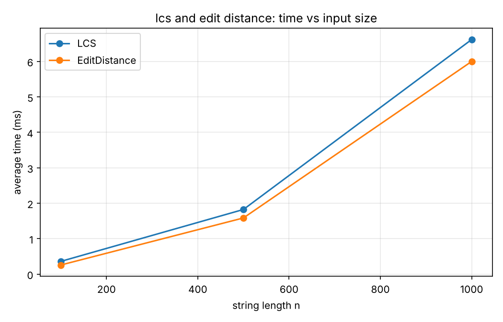
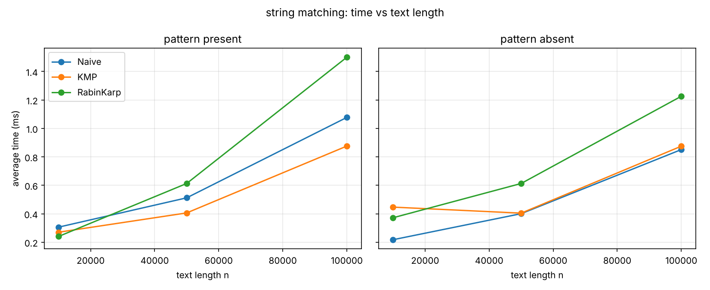
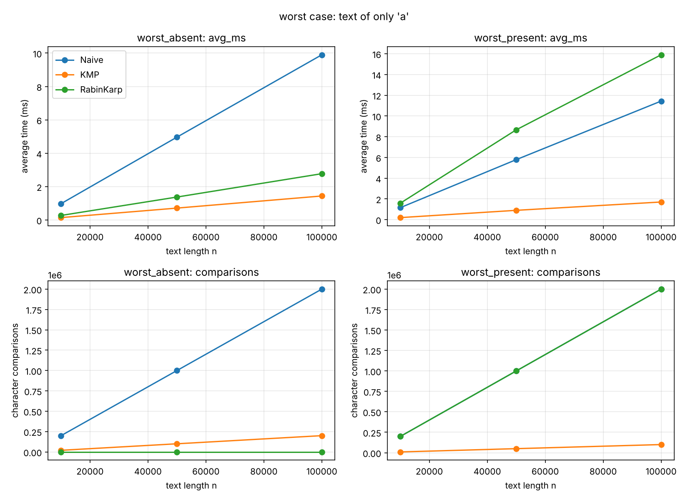
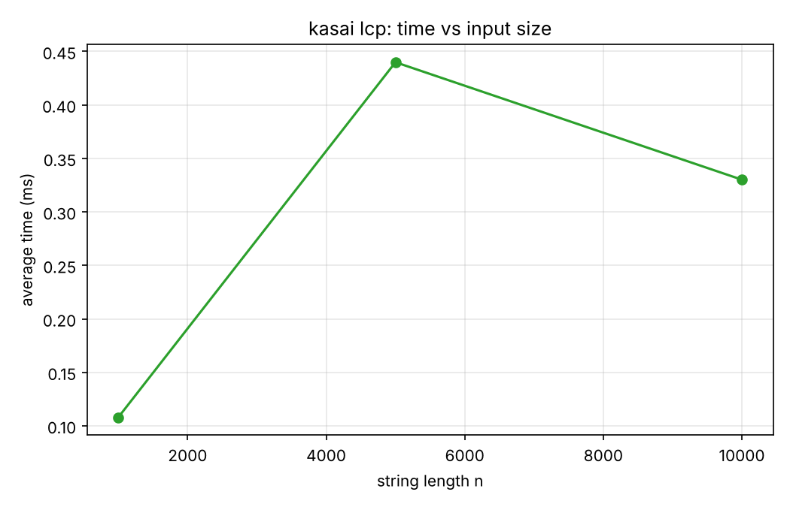

# Assignment 4: Text Analysis, Dynamic Programming and String Algorithms

This project is a Java implementation and an experimental comparison of three groups of algorithms.

Part A is dynamic programming: Longest Common Subsequence (LCS) and Edit Distance (Levenshtein distance).

Part B is string matching: Naive search, Knuth-Morris-Pratt (KMP) and Rabin-Karp.

Part C is an advanced string algorithm: Kasai's algorithm for the LCP array, together with a simple suffix array builder that is used to prepare test inputs.

All algorithms are written from scratch, without library methods such as indexOf or contains. The Java standard library is used only for data generation, collections and timing.

## Contents

1. [Problem description and algorithm overview](#1-problem-description-and-algorithm-overview)
2. [Implementation decisions and assumptions](#2-implementation-decisions-and-assumptions)
3. [Complexity analysis](#3-complexity-analysis)
4. [Testing strategy and results](#4-testing-strategy-and-results)
5. [Experimental setup and timing methodology](#5-experimental-setup-and-timing-methodology)
6. [Results: tables and plots](#6-results-tables-and-plots)
7. [Discussion: theory and experiment](#7-discussion-theory-and-experiment)
8. [Conclusion](#8-conclusion)
9. [How to build and run](#9-how-to-build-and-run)

## Project structure

```
src/
  dp/         LCS.java, EditDistance.java
  matching/   Naive.java, KMP.java, RabinKarp.java
  suffix/     SuffixArray.java, Kasai.java
  bench/      Benchmark.java
  Main.java   runs all benchmarks
tests/        AllTests.java
results/      csv files, plots, plot.py
```

## 1. Problem description and algorithm overview

### Part A. Dynamic programming

LCS. Given two strings a (length n) and b (length m), find the length of the longest sequence of characters that appears in both strings in the same order, but not necessarily next to each other. For example, LCS of "ACD" and "ABCD" is 3.

Edit Distance. Find the minimum number of insertions, deletions and substitutions that turn string a into string b. For example, turning "kitten" into "sitting" needs 3 operations.

Both algorithms use a table with (n+1) rows and (m+1) columns. Cell [i][j] answers the question for the first i characters of a and the first j characters of b.

LCS recurrence:

```
L[i][j] = L[i-1][j-1] + 1               if a[i-1] == b[j-1]
L[i][j] = max(L[i-1][j], L[i][j-1])     otherwise
base cases: L[0][j] = 0 and L[i][0] = 0
```

Why it is correct. If the last characters are equal, some optimal common subsequence can use them as its last pair, because matching them never makes the result worse. So the answer is 1 plus the answer for both shorter prefixes. If the last characters differ, they cannot both be the last matched pair, so at least one of them is not used. Dropping the last character of a or the last character of b covers both cases, and we take the better one. An empty prefix has nothing in common with anything, which gives the base cases.

Edit Distance recurrence:

```
D[i][j] = D[i-1][j-1]                                        if a[i-1] == b[j-1]
D[i][j] = 1 + min(D[i-1][j-1], D[i-1][j], D[i][j-1])         otherwise
base cases: D[i][0] = i and D[0][j] = j
```

Why it is correct. Look at the last characters of the two prefixes. If they are equal, no operation is needed for them. Otherwise the last operation of an optimal solution is one of three: a substitution (D[i-1][j-1]), a deletion of a[i-1] (D[i-1][j]) or an insertion of b[j-1] (D[i][j-1]). Each of them costs 1 and leaves a smaller subproblem, so the minimum of the three is optimal. Turning i characters into an empty string needs i deletions, and building j characters from an empty string needs j insertions, which gives the base cases.

### Part B. String matching

All three algorithms return the list of all starting indices where the pattern occurs in the text, including overlapping occurrences.

Naive. Try every starting position i from 0 to n-m and compare the pattern with the text character by character. After a mismatch the pattern shifts by one position and the comparison starts again from the beginning of the pattern.

KMP. First the pattern is preprocessed into the lps table (longest proper prefix that is also a suffix). The value lps[i] is the length of the longest proper prefix of pattern[0..i] that is also a suffix of it. For the pattern "ababaca" the table is 0 0 1 2 3 0 1.

How KMP avoids repeated comparisons. After a mismatch at pattern position j, the last lps[j-1] characters of the matched part are already known to be equal to the beginning of the pattern. So KMP moves only the pattern pointer back to lps[j-1] and never moves the text pointer back. Because of this, every text character is examined only a bounded number of times.

Rabin-Karp. The algorithm computes a hash of the pattern and a hash of every window of the text that has the same length. The hash is a polynomial with base 256, taken modulo 1,000,000,007. The hash of the next window is obtained from the previous one in constant time (a rolling hash): remove the first character, shift the rest, and add the new character.

How collisions are handled. Equal hashes do not guarantee equal strings. Whenever the two hashes are equal, the implementation compares the characters one by one. If all of them match, the position is a real occurrence. If not, it was a hash collision, which is counted in a separate collisions counter, and the search continues.

### Part C. Kasai's algorithm

Suffix array. All suffixes of a string are sorted alphabetically, and the array stores their starting positions. For "banana" it is [5, 3, 1, 0, 4, 2], which corresponds to the suffixes a, ana, anana, banana, na, nana.

LCP array. The value lcp[i] is the length of the longest common prefix of the suffixes sa[i] and sa[i-1], which are neighbours in the sorted order. The value lcp[0] is 0. For "banana" it is [0, 1, 3, 0, 0, 2]. The array shows how much neighbouring suffixes share, and it is used, for example, to find repeated substrings.

Idea of Kasai's algorithm. The suffixes are processed in text order (position 0, 1, 2, and so on) instead of sorted order. When we move from the suffix at position i to the suffix at position i+1, the first character is removed, so the common prefix with the sorted neighbour can shrink by at most 1. Therefore the current length h only decreases by one (h--) instead of being reset to 0, and this makes the whole algorithm linear. The algorithm also needs the inverse array rank, where rank[sa[i]] = i.

## 2. Implementation decisions and assumptions

1. The project is written in Java 25 in IntelliJ IDEA and is compiled with plain javac. There is no build tool and no external library.
2. Empty pattern: all three matchers return an empty list. This is our assumption, because an empty string is not treated as occurring at every position.
3. If the pattern is longer than the text, the result is an empty list.
4. Overlapping occurrences are all reported. For example, searching "aa" in "aaaaa" gives [0, 1, 2, 3].
5. Empty strings are allowed in LCS and Edit Distance. LCS with an empty string is 0, and Edit Distance with an empty string equals the length of the other string.
6. LCS and Edit Distance store the full (n+1) by (m+1) table, so their space is O(nm). Only the length or the distance is computed, not the subsequence itself or the list of edits.
7. Rabin-Karp uses base 256 and modulus 1,000,000,007. All intermediate values stay below 2^63, so long arithmetic does not overflow. After a subtraction the modulus is added back so that the value does not become negative.
8. Operation counters are static fields called comparisons. They count character comparisons. KMP also counts the comparisons made while building the lps table. Rabin-Karp counts only the character comparisons of the verification step, not the arithmetic of the hash, and it also has a collisions counter. Kasai counts the character comparisons of its inner loop.
9. The suffix array for Kasai is built by SuffixArray.buildSimple, which sorts all suffixes with a comparison sort. It is simple but slow for large strings (worst case O(n^2 log n)). The assignment allows this. The builder is used only to prepare the input, and it is not part of the timed region.
10. All random strings use the alphabet abcd (4 letters).

## 3. Complexity analysis

Here n is the text length (or the length of the first string), and m is the pattern length (or the length of the second string).

| Algorithm | Main operation or recurrence | Best case time | Worst case time | Auxiliary space | Justification |
|---|---|---|---|---|---|
| LCS | L[i][j] = L[i-1][j-1] + 1 if equal, else max(L[i-1][j], L[i][j-1]) | Θ(nm) | Θ(nm) | O(nm) | Every cell of the table is filled once with O(1) work, and the whole table is stored. |
| Edit Distance | D[i][j] = D[i-1][j-1] if equal, else 1 + min(D[i-1][j-1], D[i-1][j], D[i][j-1]) | Θ(nm) | Θ(nm) | O(nm) | Same table structure and O(1) work per cell. |
| Naive | compare the pattern at every shift | Θ(n), when the first character mismatches almost everywhere | Θ((n-m+1)·m) = O(nm), for example text aaaa... with pattern aaa...ab | O(1) | There are n-m+1 shifts, and each shift needs up to m comparisons. |
| KMP | lps table, then one pass over the text | O(n + m) | O(n + m) | O(m) | The lps table is built in O(m). In the search the text pointer never moves back, and the pattern pointer can fall back only as far as it has advanced, so the total number of steps is at most about 2n. |
| Rabin-Karp | rolling hash, plus verification when hashes are equal | O(n + m) | O(nm) | O(1) | Hashing costs O(m) at the start and O(1) per shift. The expected time is O(n + m) because collisions are rare. The worst case happens when many windows have the same hash as the pattern (collisions, or real matches such as aaaa...), and each of them needs a full O(m) check. |
| Kasai (LCP) | h grows while characters match and decreases by 1 per step | O(n) | O(n) | O(n) | The value h increases only in the inner loop and decreases by at most 1 per outer step, so the total number of increments is at most 2n. The algorithm stores rank and lcp, which is O(n). The suffix array is an input. |

Theory and measurement. The table above is theoretical complexity. It describes the growth rate and does not depend on the computer. Section 6 gives measured values (milliseconds and operation counts), which also depend on the hardware, the JVM and the background load of the machine.

Expected and worst case. Naive and Rabin-Karp have different expected and worst case bounds. On random text over a 4 letter alphabet, a mismatch is found after about 4/3 comparisons per position on average, so Naive behaves like O(n). On a text that consists only of the letter a, it becomes O(nm). Rabin-Karp is O(n + m) in expectation, because collisions are rare (we observed 0 collisions in all experiments), but it also becomes O(nm) when the pattern matches almost everywhere. KMP and Kasai have the same bound in every case.

## 4. Testing strategy and results

The tests are in tests/AllTests.java. They use a small check helper instead of an external test library, so the project can be compiled with plain javac. The program prints pass or fail for each check and exits with code 1 if any check fails.

For every string matching test, the same input is given to Naive, KMP and Rabin-Karp. The test checks two things: each result equals the expected list, and all three lists are equal to each other.

| Area | Cases covered |
|---|---|
| LCS | identical strings, completely different strings, an empty string (first and second), the example ACD and ABCD |
| Edit Distance | identical strings, one empty string (both directions), substitution, insertion, deletion, kitten and sitting |
| String matching | pattern at the beginning, in the middle and at the end, multiple occurrences, overlapping occurrences, pattern absent, pattern longer than the text, empty pattern, and the lps table of ababaca |
| Kasai | banana (suffix array [5,3,1,0,4,2], expected LCP [0,1,3,0,0,2], checked by hand) and aaaa (suffix array [3,2,1,0], expected LCP [0,1,2,3]) |

Result: passed: 49, failed: 0.

Manual check for banana. The sorted suffixes are a, ana, anana, banana, na, nana. The common prefixes of the neighbours are: a and ana share 1 character, ana and anana share 3, anana and banana share 0, banana and na share 0, na and nana share 2. This gives [0, 1, 3, 0, 0, 2].

In addition, before every timing the benchmark checks that the three matching algorithms return identical lists on the benchmark input, and it stops with an error otherwise.

## 5. Experimental setup and timing methodology

Environment: Windows 11 laptop, Intel Core i7-1255U (10 cores, 12 logical processors, base speed 1.70 GHz), 15.7 GB RAM, JDK 25, IntelliJ IDEA 2025.2.5.

Input sizes, taken from the assignment:

| Experiment | Sizes |
|---|---|
| LCS | two strings of length 100, 500 and 1000 |
| Edit Distance | two strings of length 100, 500 and 1000 (the same strings as for LCS) |
| String matching | text length 10,000, 50,000 and 100,000 |
| Kasai | string length 1,000, 5,000 and 10,000 |

Data generation. Random strings over the alphabet abcd are generated with java.util.Random and the fixed seed 42. There is one generator per experiment group, so the data is the same in every run.

Patterns for string matching have length 20. There are two kinds of pattern. The present pattern is a substring taken from the middle of the text, so it occurs at least once. The absent pattern is a random string of 20 characters, and it is generated again until Naive confirms that it does not occur in the text. The same text and the same pattern are used for Naive, KMP and Rabin-Karp in every comparison.

Additional worst case experiment. This experiment is not required, and we added it to compare the expected and the worst case. The text consists of n letters a (n is 10,000, 50,000 and 100,000), and two patterns of length 20 are used. The first pattern, called worst_absent, is 19 letters a followed by the letter b. It never occurs, but Naive compares 19 characters at every position. The second pattern, called worst_present, is 20 letters a. It occurs at almost every position.

Timing methodology:

1. Time is measured with System.nanoTime() around the algorithm call only. Input generation, console output and file writing are outside the timed regions. The result files are written after all measurements are finished.
2. Every experiment is first run 100 times as a warmup, so that the JIT compiler can optimize the code. After that 5 timed runs are made, and the average in milliseconds is reported.
3. The result of every call is added to a variable called sink, so that the JVM cannot remove the call as unused code.
4. Operation counters are incremented inside the algorithms, so they add a small constant cost to the time of each algorithm. The counters themselves do not depend on the machine.
5. Raw results are saved in results/*.csv, and the plots are produced from them by results/plot.py.

## 6. Results: tables and plots

All times are averages of 5 runs, in milliseconds.

### 6.1 LCS and Edit Distance

| n (both strings) | LCS (ms) | Edit Distance (ms) |
|---|---|---|
| 100 | 0.0610 | 0.2290 |
| 500 | 1.5181 | 1.5048 |
| 1000 | 5.4488 | 9.3652 |



### 6.2 String matching on random text

The tables show time in milliseconds and the number of character comparisons (cmp). First, the pattern is present in the text, with 1 occurrence.

| n | Naive (ms) | Naive cmp | KMP (ms) | KMP cmp | Rabin-Karp (ms) | Rabin-Karp cmp |
|---|---|---|---|---|---|---|
| 10,000 | 0.0545 | 13,433 | 0.0544 | 12,544 | 0.5388 | 20 |
| 50,000 | 0.5590 | 66,562 | 0.4162 | 62,413 | 0.6117 | 20 |
| 100,000 | 0.7958 | 133,426 | 0.8286 | 125,092 | 1.2413 | 20 |

Now the pattern is absent from the text, with 0 occurrences.

| n | Naive (ms) | Naive cmp | KMP (ms) | KMP cmp | Rabin-Karp (ms) | Rabin-Karp cmp |
|---|---|---|---|---|---|---|
| 10,000 | 0.0532 | 13,376 | 0.0811 | 12,550 | 0.1307 | 0 |
| 50,000 | 0.3797 | 66,627 | 0.5728 | 62,432 | 0.6147 | 0 |
| 100,000 | 0.9373 | 133,476 | 1.2819 | 123,508 | 3.3443 | 0 |

Rabin-Karp had 0 hash collisions in all runs.



### 6.3 String matching, worst case (text of only the letter a)

The pattern worst_absent is aaaaaaaaaaaaaaaaaaab and it has 0 occurrences.

| n | Naive (ms) | Naive cmp | KMP (ms) | KMP cmp | Rabin-Karp (ms) | Rabin-Karp cmp |
|---|---|---|---|---|---|---|
| 10,000 | 0.9791 | 199,620 | 0.1443 | 20,018 | 0.2735 | 0 |
| 50,000 | 4.9654 | 999,620 | 0.7143 | 100,018 | 1.3761 | 0 |
| 100,000 | 9.8997 | 1,999,620 | 1.4398 | 200,018 | 2.7759 | 0 |

The pattern worst_present is aaaaaaaaaaaaaaaaaaaa and it has n-19 occurrences.

| n | Naive (ms) | Naive cmp | KMP (ms) | KMP cmp | Rabin-Karp (ms) | Rabin-Karp cmp |
|---|---|---|---|---|---|---|
| 10,000 | 1.1561 | 199,620 | 0.1954 | 10,019 | 1.5869 | 199,620 |
| 50,000 | 5.7858 | 999,620 | 0.8979 | 50,019 | 8.6642 | 999,620 |
| 100,000 | 11.4339 | 1,999,620 | 1.7008 | 100,019 | 15.8995 | 1,999,620 |



### 6.4 Kasai's algorithm

| n | Time (ms) | Character comparisons |
|---|---|---|
| 1,000 | 0.1080 | 1,990 |
| 5,000 | 0.4399 | 9,991 |
| 10,000 | 0.3301 | 19,988 |



## 7. Discussion: theory and experiment

Measurement noise. Many of the measured times are far below one millisecond. At this scale the time is affected by the JVM (JIT compilation and garbage collection), by other programs running on the laptop, and by the timer resolution. We saw this directly: repeated runs of the same program gave different times. For example, the ratio between the Edit Distance time for n = 1000 and for n = 500 was between about 3.8 and 6.2 in different runs. For this reason the operation counts are the more reliable evidence for comparing algorithms, and the milliseconds should be read only as a rough trend. For the longer measurements (several milliseconds) the trends match the theory well.

LCS and Edit Distance. Both fill a table of n by n cells, so the theory predicts Θ(n^2), which means that doubling n should make the time about 4 times larger. From n = 500 to n = 1000 the measured time grew about 3.6 times for LCS and between 3.8 and 6.2 times for Edit Distance, depending on the run. This agrees with quadratic growth plus noise. From n = 100 to n = 500 the growth is smaller than the theoretical 25 times, because for small sizes the fixed costs (allocating the table and the JIT warmup) dominate. The two algorithms have almost the same running time, which is expected: the table has the same size and each cell needs O(1) work. Edit Distance only has one more comparison, because it takes a minimum of three neighbours instead of two.

String matching on random text. All three algorithms grow roughly linearly with the text length, as predicted. The comparison counts show the expected case behaviour clearly. Naive makes about 1.33n comparisons (133,426 for n = 100,000), which agrees with the expected value 1 + 1/4 + 1/16 + ... = 4/3 comparisons per position on a 4 letter alphabet. KMP makes about 1.25n comparisons, only slightly fewer, because on random text Naive almost never has long partial matches that KMP could reuse. Rabin-Karp makes almost no character comparisons (20 when the pattern is present and 0 when it is absent), because the hash rejects every wrong window. However, this does not make it faster in time. It computes a hash update (multiplications and modulo operations) at every position, and this costs more than one character comparison. In the measured times Rabin-Karp is the slowest or close to the others on random text.

Worst case. On a text of only the letter a, the difference between the algorithms is large, and it matches the theory exactly. For worst_absent with n = 100,000, Naive makes 1,999,620 comparisons, which equals (n - m + 1) · m with m = 20, so it is O(nm). KMP makes about 2n = 200,018 comparisons, which is linear. This is about 10 times fewer comparisons and about 7 times less time (1.44 ms against 9.90 ms). Rabin-Karp makes 0 comparisons here, because every window aaaaaaaaaaaaaaaaaaaa has a different hash from the pattern aaaaaaaaaaaaaaaaaaab. For worst_present every window is a real match, so Rabin-Karp must verify every window and reaches 1,999,620 comparisons, the same as Naive. On top of that it computes hashes, so it is the slowest (15.9 ms against 11.4 ms for Naive and 1.7 ms for KMP). KMP needs only n + m - 1 = 100,019 comparisons, because after each full match it continues from lps[m-1] instead of starting again. This experiment shows the difference between the expected O(n + m) and the worst case O(nm) of Rabin-Karp, and the guaranteed O(n + m) of KMP.

Kasai. The comparison counts (1,990, 9,991 and 19,988) are just below 2n for all sizes, exactly as the proof predicts, because h increases at most 2n times in total. So the algorithm is linear. The measured times (0.11, 0.44 and 0.33 ms) are too small and too noisy to show the trend, and they are not even increasing, so for Kasai we rely on the counters. The suffix array is not included in these times, because it is built outside of the timed region by the simple method.

Limitations. Only one random text per size was used (with a fixed seed), the alphabet is small (4 letters), and 5 timed runs on a laptop are not enough to remove all the noise. The results should be read as a demonstration of trends, not as exact constants.

## 8. Conclusion

LCS and Edit Distance both need Θ(nm) time and space with a simple table. Their problem size is the same, and their running times are about the same. The memory can be reduced to O(min(n, m)) if only the value is needed, but we did not do this.

Naive is the simplest algorithm and it works well on random text (about 4n/3 comparisons), but its worst case is O(nm).

KMP needs extra preprocessing and O(m) memory, but it guarantees O(n + m) in every case. So it is the safest choice when the text can be repetitive or chosen by an attacker. On random text its advantage is small.

Rabin-Karp is very good at rejecting positions, with almost no character comparisons, and it is easy to extend to several patterns. But every position costs a hash update, and in the worst case (many real matches or many collisions) it is as slow as Naive or even slower.

Kasai builds the LCP array in O(n) time and O(n) extra memory when the suffix array is already available. In practice, the main cost is building the suffix array.

Operation counts are a more stable way to compare algorithms than millisecond timings from a small laptop experiment, and in all experiments they agree with the theoretical analysis.

## 9. How to build and run

Requirements: JDK 17 or newer (the project was developed with JDK 25). Run all commands from the root folder of the repository, because the program writes to the results folder using a relative path.

Compile the program:

```
javac -d out src/Main.java src/bench/Benchmark.java src/dp/LCS.java src/dp/EditDistance.java src/matching/Naive.java src/matching/KMP.java src/matching/RabinKarp.java src/suffix/SuffixArray.java src/suffix/Kasai.java
```

Run the benchmarks. This takes about a minute, prints the tables and rewrites results/*.csv:

```
java -cp out Main
```

Compile and run the tests:

```
javac -d out -cp out tests/AllTests.java
java -cp out AllTests
```

The last line of the output should be: passed: 49, failed: 0

Rebuild the plots. This needs Python 3 and the matplotlib package (pip install matplotlib):

```
python results/plot.py
```

Timings on another computer will differ from the tables above, but the operation counts and the general trends should be the same.